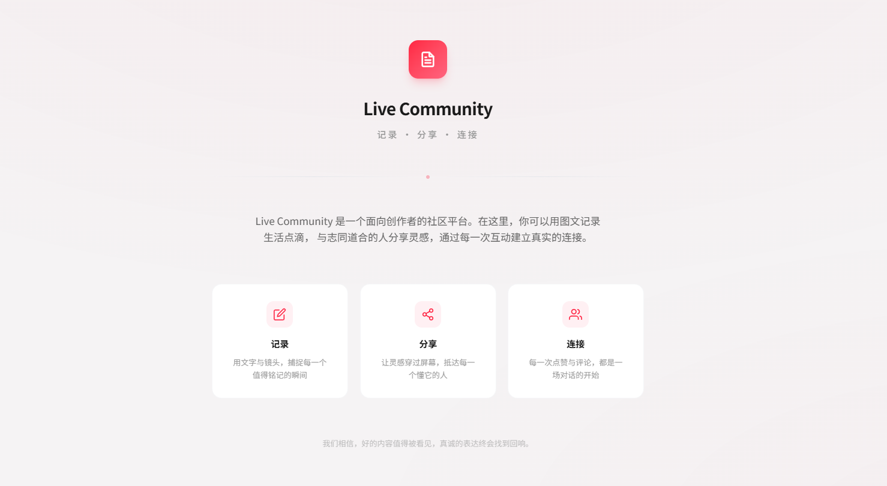
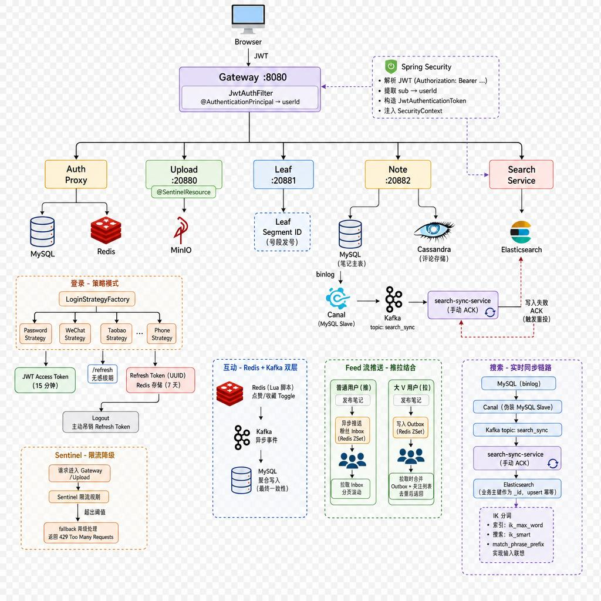
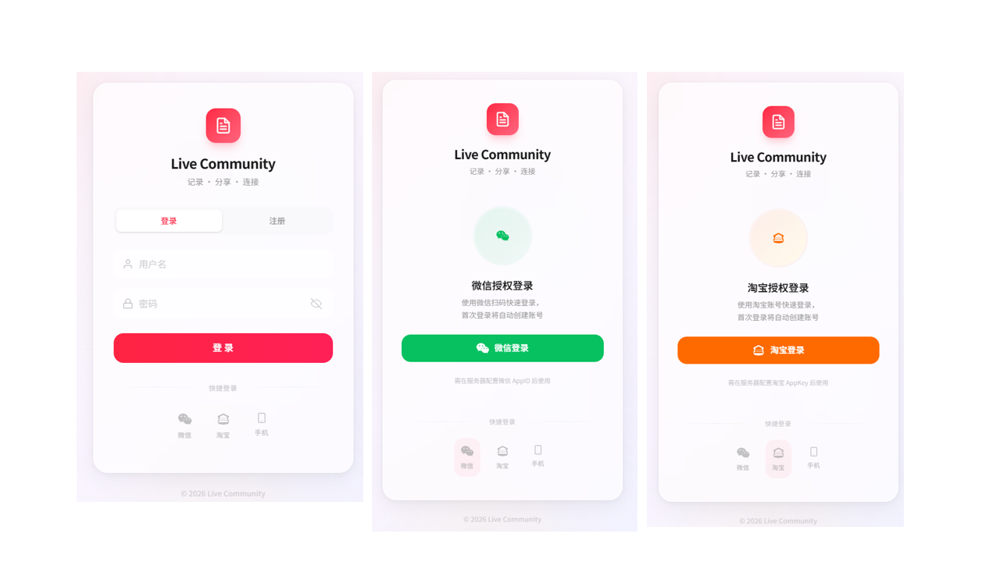
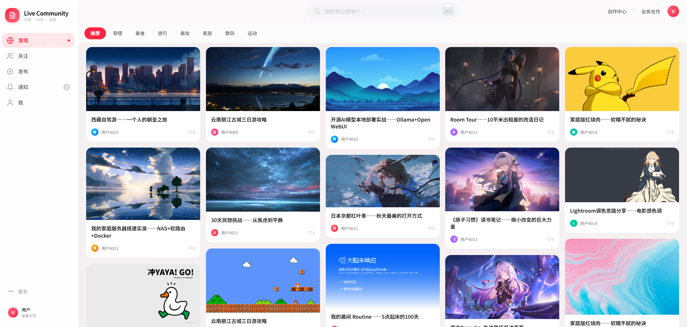
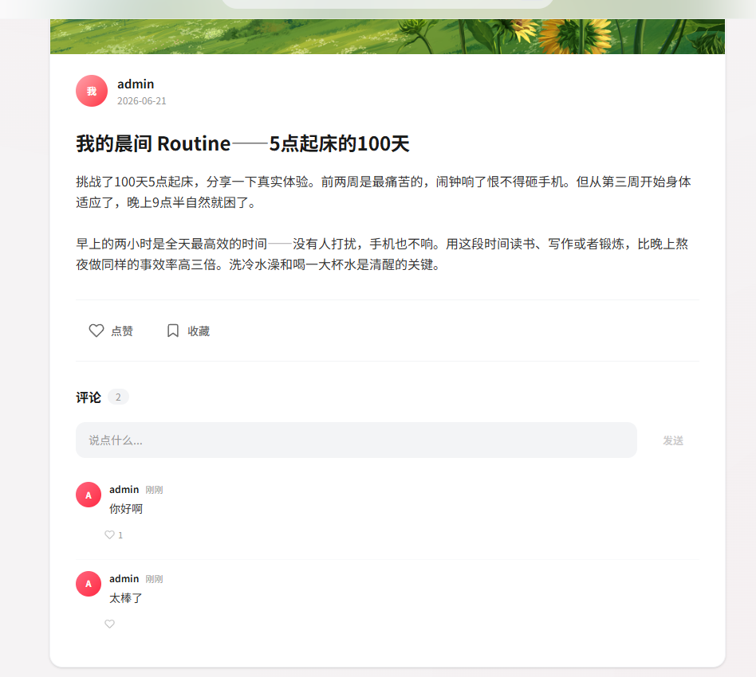
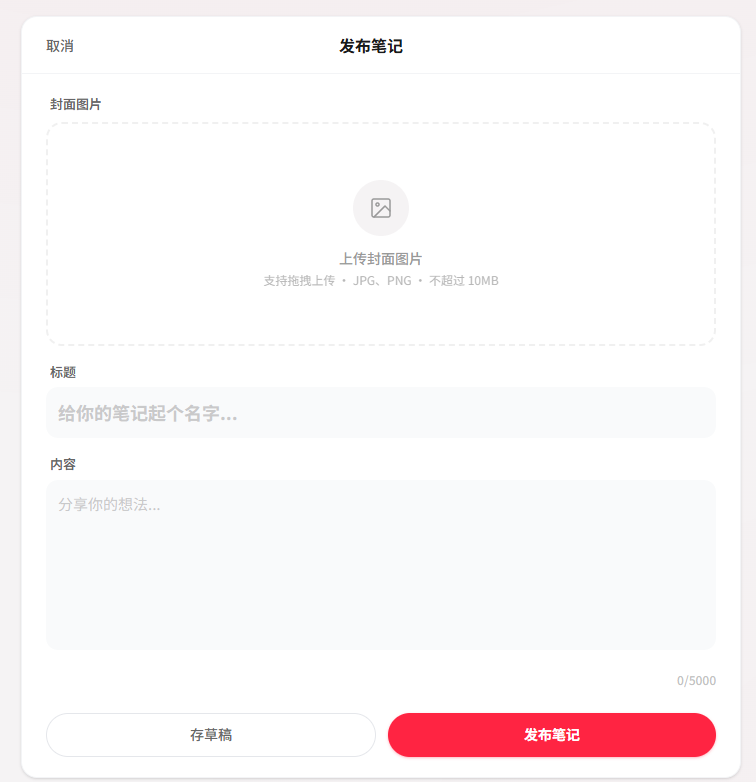
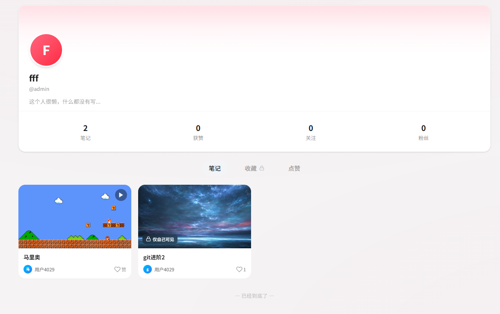
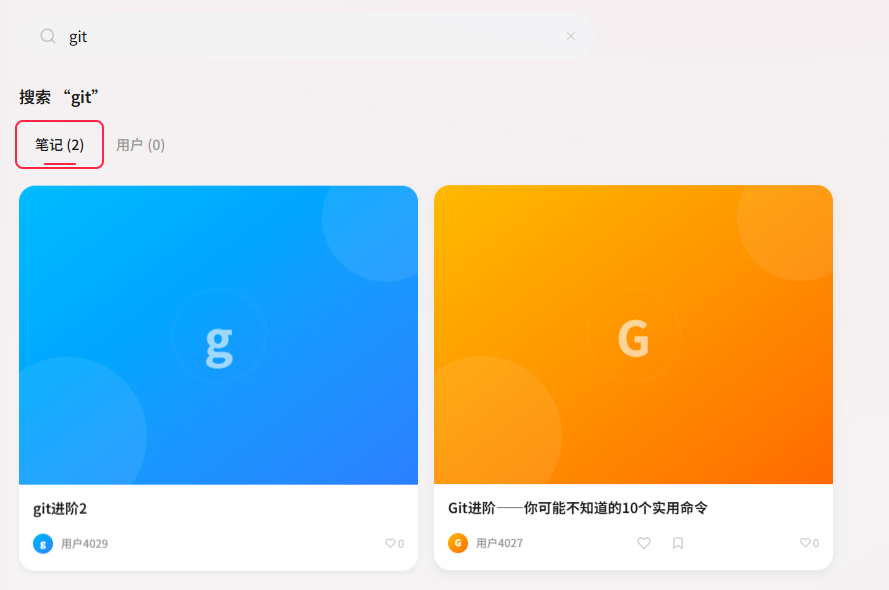
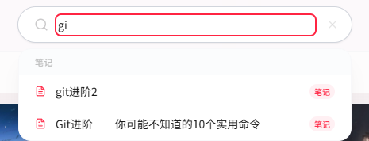
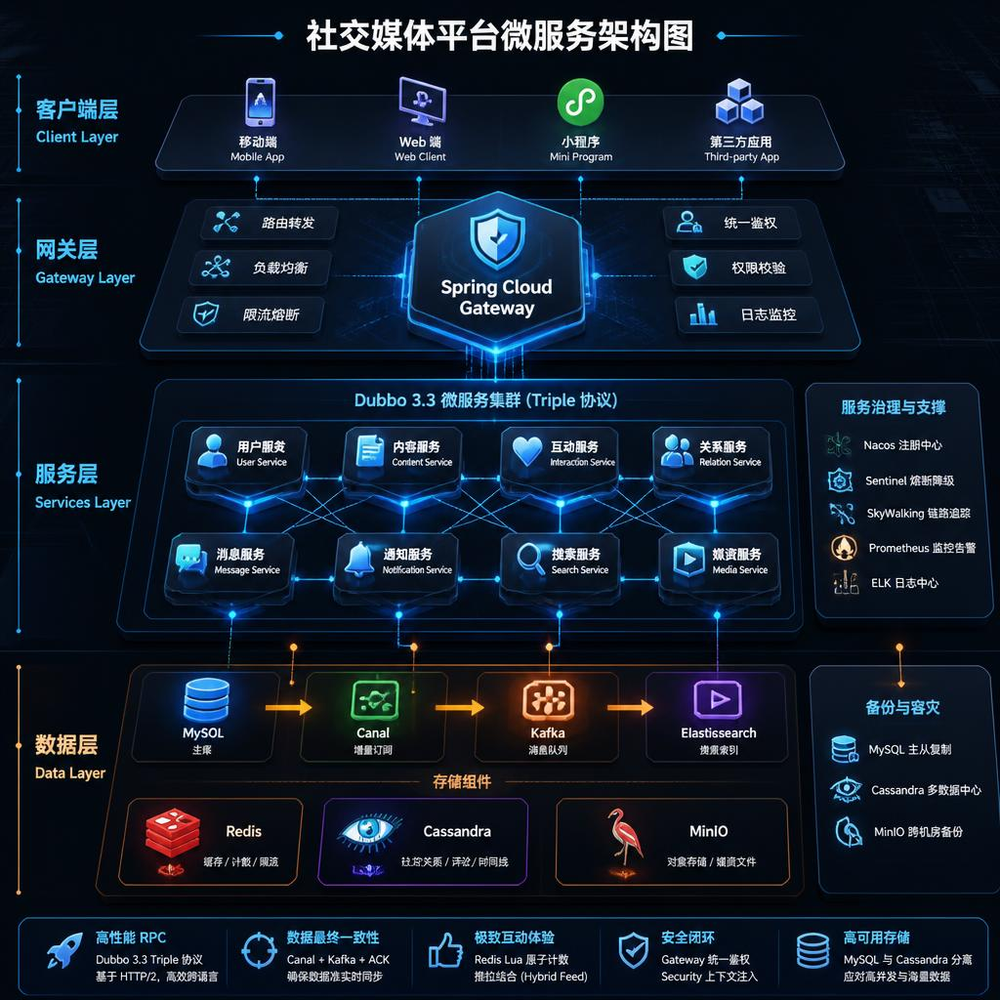

# live-community

高并发生活分享社区 — 笔记发布、点赞收藏、评论互动、全文搜索，基于 Spring Cloud Alibaba 微服务架构。


## 架构 



## 目录与服务划分

```text
gateway/                 HTTP 网关
services/
  account/               账号与认证（auth-service）
  community/             笔记、评论、互动（community-api + note-service）
  media/                 文件与对象存储（upload-api + upload-service）
  search/                搜索域（search-api + 查询服务 + 同步 Worker）
platform/
  common-core/           无框架基础类型
  security/              JWT、HTTP 安全与内部 RPC 安全
  messaging/             事务 Outbox
  id/                    Leaf API、客户端与发号服务
front/                   前端
deploy/                  Elasticsearch 镜像与 Canal 演示配置
scripts/                 启动、迁移、对账和结构检查
docs/                    设计与运维文档
```

7 个可部署进程分别是网关、账号、社区、媒体、搜索查询、搜索同步、Leaf。`*-api` 和平台客户端是库；各层 `pom.xml` 负责聚合构建。详细职责、依赖方向和新增模块规则见 [项目结构与服务边界](docs/项目结构与服务边界.md)。

## 技术栈

| 层级 | 技术 |
|------|------|
| 框架 | Spring Boot 3.2 + Spring Cloud 2023.0.3 + Alibaba 2023.0.1 |
| RPC | Apache Dubbo 3.3 (Triple 协议 + Nacos 注册发现) |
| 服务治理 | Sentinel 限流降级 |
| 数据库 | MySQL 8.0（账号、笔记、评论、互动、文件元数据） |
| 缓存 | Redis 7（Token 会话；互动权威状态在 MySQL） |
| 消息队列 | Kafka 7.6 KRaft（Outbox 搜索同步及计数投影） |
| 对象存储 | MinIO 预签名 URL 直传 |
| 搜索引擎 | Elasticsearch 8.12 + IK 中文分词 |
| 数据同步 | 业务事务 Outbox → Kafka → search-sync → ES 外部版本控制 |
| 分布式 ID | Meituan Leaf (号段 + 雪花算法) |
| 安全 | Spring Security + JWT 双 Token (access 15min / refresh 7d) |
| 前端 | React 18 + TypeScript + Tailwind CSS + Vite |

## 功能

| | |
|--|--|
| <br>**登录/注册** — 账号密码、手机验证码、微信 OAuth、淘宝 OAuth | <br>**Feed 流首页** — 分类 Tab + 瀑布流无限滚动笔记卡片 |
| <br>**笔记详情** — 图文详情 + 点赞/收藏 + 评论区 | <br>**发布笔记** — 标题 + 内容 + 封面图上传，存草稿或发布 |
| <br>**个人主页** — 用户信息 + 笔记 Tab（我的/收藏/点赞），支持编辑资料 |<br> **关注页（规划）** — 当前未实现关注关系及推拉 Feed <br>|
| <br>**关键词搜索** —  按照笔记的点赞数 + 浏览数 + 评论数等计算 |<br> **联想功能** — 输入实时联想前缀匹配 <br>|


## 架构与实现要点

### Gateway — 普通 HTTP 路由

Spring Cloud Gateway 通过 Nacos 发现下游，转发 `/api/auth/**`、`/api/note/**`、`/api/interaction/**`、`/api/upload/**`、`/api/search/**`。网关负责 Token 校验、HTTP 路由、跨域、追踪和实例级限流；不调用 Dubbo，不写领域 Redis。业务服务独立验证 Token 并校验资源权限，内部同步调用使用带签名的 Dubbo。

### 文件和发布

创建草稿 → `/api/upload/prepare` → MinIO PUT → `/api/upload/confirm` → `/api/note/publish`。文件服务检查实际大小、类型和文件头，使用 ETag 条件复制到不可变正式对象；文件在申请时绑定用户和笔记。笔记服务仅保存文件引用，验证作者后发布。历史对象 Key 由文件服务兼容解析。MinIO 签名地址必须能由浏览器和业务服务访问，不对签名 URL 改写主机或路径。

### 评论和互动

评论已迁移到 MySQL，索引、内容、主题计数采用本地事务。点赞和收藏采用“设置目标状态”接口：`desiredActive` + `requestId`，关系和权威计数在同一事务内更新；重复请求不反转状态。事务 Outbox 发送绝对计数和版本，笔记、评论各自维护计数投影，旧事件不能覆盖新投影。

### 搜索和恢复

账号、内容在业务事务内写入各自 Outbox，Worker 消费 `search_documents`，使用 ES 外部版本控制和删除墓碑，避免旧消息覆盖或复活已删除内容。失败持续重试，不跳过失败记录。重建、对账及迁移工具见 [实施与部署记录](docs/微服务修复实施与部署.md)。Canal 是 `canal-demo` profile 下的独立演示，不写正式同步 topic。

### 列表和浏览量

当前首页是按发布时间排序的笔记列表，支持分页；关注关系及 Inbox/Outbox 推拉 Feed 尚未实现。浏览计数在内容服务中通过访问幂等记录与笔记更新的本地事务持久化，网关不参与结算。

### 验证范围

回归测试覆盖本地 HTTP 网关、JWT、RPC 签名、SQL 事务、幂等、乱序投影及失败重试；MySQL、Kafka、MinIO、Nacos 和 ES 联调及吞吐、延迟分位数需在基础设施环境执行，当前没有高并发性能结论。

## 快速开始

### 环境要求
JDK 17+ · Docker Desktop · Maven 3.6+ · Node 18+ · Python 3.10+

### 1. 启动基础设施
```bash
docker compose up -d
```
等待 Nacos、MySQL、Redis、Kafka、MinIO、ES 就绪。Canal 默认不启动，Cassandra 不再参与当前链路。

启动应用前安装 `scripts/requirements-boundaries.txt`，备份已有数据并停止旧写入及消费者，执行边界迁移和索引初始化。完整步骤见 [实施与部署记录](docs/微服务修复实施与部署.md)，不能直接用旧配置启动新版。

### 2. 初始化
```bash
bash scripts/init-all.sh
```
注册 Nacos 配置 → 创建 ES 索引 (IK 分词) → 写入测试数据。

### 3. 启动后端
```bash
bash scripts/start-all.sh
```
按依赖顺序启动：leaf → upload → note → auth → search → search-sync → gateway。

```bash
# 或先安装父 POM 与契约，再逐个模块启动
mvn install -DskipTests
mvn -pl :leaf-service spring-boot:run &
mvn -pl :upload-service spring-boot:run &
mvn -pl :note-service spring-boot:run &
mvn -pl :auth-service spring-boot:run &
mvn -pl :search-service spring-boot:run &
mvn -pl :search-sync-service spring-boot:run &
mvn -pl :gateway spring-boot:run &
```

### 4. 启动前端
```bash
cd front && npm install && npm run dev
```
浏览器打开 `http://localhost:5173`。

### 验证
```bash
curl -X POST http://localhost:8080/api/auth/login \
  -H 'Content-Type: application/json' \
  -d '{"username":"test","password":"123456"}'

curl http://localhost:8080/api/note/list

curl http://localhost:8080/api/search/note?q=美食
```
## 路线图

- [ ] **内容审核** — 文本敏感词过滤 (DFA 算法) + 图片审核 (对接阿里云/腾讯云内容安全 API)，发布/评论先审后发
- [ ] **AI 摘要与续写** — 接入 LLM 生成笔记摘要与写作续写建议，摘要结果缓存 Redis 避免重复调用
- [ ] **私信聊天** — WebSocket 实时通信，消息落库 MySQL + 最近会话 Redis ZSet，支持离线消息拉取
- [ ] **热度排行榜** — 热度排行榜
- [ ] **Feed 流实现与压测** — 先实现关注及推拉 Feed，再使用 JMeter/Gatling 做基准压测，产出 QPS/延迟分位数报告
- [ ] **可观测性** — Micrometer + Prometheus 指标暴露，Grafana 大盘展示各服务 QPS / RT / 错误率
- [ ] **搜索排序优化** — ES BM25 + 互动权重 (点赞/收藏/评论数) 加权召回，CTR 埋点反馈调参


## vibe coding相关
## Skills
* [前端界面设计实现Skill](https://github.com/ConardLi/garden-skills/blob/main/skills/web-design-engineer)
* superpowers
* draw.io skill

## AI 工具

